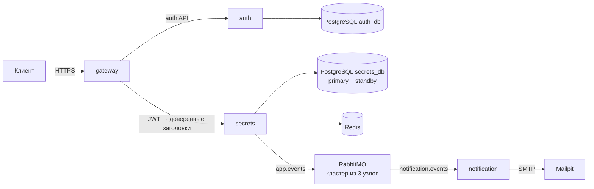

Сервис передачи секретов: регистрация и вход, текстовые секреты с TTL,
одобрение доступа автором и уведомления по email. Общий стек запускается
из корня репозитория через [docker-compose.yml](docker-compose.yml).



| Компонент | Ответственность |
| --- | --- |
| `gateway` | HTTPS, проверка RS256 JWT, лимит входа, маршрутизация |
| `auth` | Регистрация, argon2id, JWT на 15 минут, своя PostgreSQL |
| `secrets` | AES-256-GCM, TTL, запросы доступа, аудит, Redis и outbox |
| `notification` | Чтение RabbitMQ и отправка писем через Mailpit |

Для запуска нужны Docker с Compose v2, Make и OpenSSL:

```sh
make up
make ps
```

`make up` создаёт недостающие ключи и пароли, собирает четыре приложения и
ожидает готовности всех **двенадцати контейнеров**. Миграции обеих PostgreSQL
применяются приложениями при старте. Gateway: [https://localhost](https://localhost),
письма Mailpit: [http://127.0.0.1:8025](http://127.0.0.1:8025).
Первый запуск создаёт самоподписанный TLS-сертификат для localhost и 127.0.0.1;
для curl используйте `--cacert .secrets/tls_certificate.pem`.
TLS завершается на gateway; внутри стека сервисы используют HTTP, без mTLS.
Healthcheck gateway проверяет локальный TCP-порт. HTTPS и сертификат проверяет
внешний smoke-тест.

Несекретные параметры находятся в `.env` (шаблон — `.env.example`). Если порт 443
занят, например, задайте `HTTPS_PORT=8443` и `PUBLIC_BASE_URL=https://localhost:8443`.
Один `PUBLIC_BASE_URL` используется и для ссылок секретов, и для писем.
`MAILPIT_PORT` меняет локальный порт интерфейса Mailpit.

Ключи и пароли находятся в `.secrets/`, исключены из Git и подключаются файлами
Docker secrets. Auth получает приватный RSA-ключ, gateway — публичный ключ той же
пары; secrets получает только мастер-ключ AES. Каждый процесс получает только
нужные ему секреты. Каталог на хосте имеет права 0700, файлы читаются UID 65532
контейнеров. `make init` сохраняет существующие файлы и проверяет соответствие JWT-ключей.
Для настоящего домена замените `.secrets/tls_certificate.pem` и
`.secrets/tls_private_key.pem` своим сертификатом и ключом.

Общий Compose использует отдельный проект `simple-vault-stack`. Он не изменяет
контейнеры, ключи и volumes автономных стеков в подкаталогах; их данные
автоматически не переносятся. `make down` сохраняет все volumes и `.secrets/`.
После создания БД или RabbitMQ простая замена файла пароля не меняет пароль
в хранилище; мастер-ключ нужен для расшифровки уже сохранённых секретов.

Снаружи опубликован только HTTPS gateway; интерфейс Mailpit привязан к loopback
для локальной проверки писем. Порты auth, secrets, обеих БД, Redis, AMQP и SMTP
на хост не публикуются. Сегментация описана целиком в `docker-compose.yml`:

| Сеть | Участники |
| --- | --- |
| `edge` | gateway; опубликован HTTPS |
| `gw-auth` | gateway, auth |
| `gw-secrets` | gateway, secrets |
| `auth-data` | auth, postgres-auth |
| `secrets-db` | secrets, postgres-secrets, postgres-secrets-replica |
| `secrets-cache` | secrets, redis |
| `events-publish` | secrets, rabbitmq-1..3 |
| `events-consume` | notification, rabbitmq-1..3 |
| `mail` | notification, mailpit |
| `mail-ui` | mailpit; UI опубликован на loopback |

Все сети, кроме `edge` и `mail-ui`, объявлены `internal`. У notification нет
общей сети с secrets, у Redis — с PostgreSQL. Сервисы обращаются к RabbitMQ
через разные сети публикации и чтения; контракты API и событий сохраняются.
Доверенные заголовки `X-User-ID`, `X-User-Email`, `X-Real-IP` создаёт gateway
после проверки JWT.

Это изоляция сегментов средствами Docker. Внутри одной сети доступ остаётся
двусторонним на все слушающие порты; отдельных правил firewall по портам и
направлениям здесь нет. Для такого ограничения нужен дополнительный firewall.

Очередью `notification.events`, её bindings и DLQ владеет notification.
Secrets публикует в `app.events` с подтверждениями; пока очереди нет, событие
остаётся в outbox. Временная недоступность SMTP не подтверждает сообщение раньше
отправки письма. Текста секрета в событиях и письмах нет.

| Команда | Действие |
| --- | --- |
| `make up` | Инициализация, сборка и запуск всего стека |
| `make down` | Остановка с сохранением данных |
| `make ps` | Контейнеры и healthchecks |
| `make logs SERVICE=notification` | Логи выбранного сервиса; без SERVICE — всех |
| `make restart` | Перезапуск компонентов |
| `make config` | Проверка Compose |
| `make test` | Go vet и тесты с race detector во всех четырёх модулях |
| `make smoke` | Регистрация → вход → секрет → одобрение/отзыв → письма Mailpit |
| `make db-status` | Роли узлов secrets_db и отставание реплики |
| `make db-promote` / `make db-rejoin` | Переключение secrets_db на standby / возврат старого primary репликой |
| `make backup` | Проверенные копии обеих баз в `backups/` |
| `make restore FILE=...` | Восстановление базы из копии |
| `make demo-db-failover` | Демо: отказ primary СУБД и переключение на standby |
| `make demo-mq-failover` | Демо: отказ узла-лидера RabbitMQ |
| `make demo-backup` | Демо: копия → потеря данных → восстановление |

Для `make test` нужен Go 1.26+, для `make smoke` — Python 3 без дополнительных
пакетов. Smoke использует настоящие auth и notification, не очищает общую очередь
или Mailpit и удаляет свой секрет. Уникальные тестовые аккаунты остаются в auth_db:
операции удаления аккаунта в API нет. Повторять smoke следует с интервалом не меньше
минуты из-за лимита входа по IP. Низкоуровневый destructive integration-тест consumer
notification не запускается общим `make test`; он предназначен для отдельного брокера.

## Надёжность

`secrets_db` работает парой primary + hot standby на потоковой репликации;
secrets знает оба узла и сам находит тот, что принимает запись. Переключение
ручное (`make db-promote`) и изолирует старый primary, чтобы не было двух мастеров.
RabbitMQ — кластер из трёх узлов с quorum-очередями: отказ любого узла, включая
лидера очереди, не останавливает доставку. `make backup` делает полные копии обеих
баз с проверочным восстановлением. Схема, демонстрация, SLO, MTBF, MTTR, RTO и RPO
с обоснованием — в [docs/reliability.md](docs/reliability.md).

Стек с кластером использует новые volumes (`secrets-replica-data`,
`rabbitmq-1..3-data`). Данные прежнего одиночного `rabbitmq-data` не переносятся;
неотправленные события остаются в outbox secrets. Если в старом брокере уже была
classic-очередь `notification.events`, удалите её — тип очереди при повторном
объявлении не меняется.

Контракты и локальная разработка описаны в README соответствующих сервисов:
[gateway](gateway/README.md), [auth](auth/README.md), [secrets](secrets/README.md),
[notification](notification/README.md).
