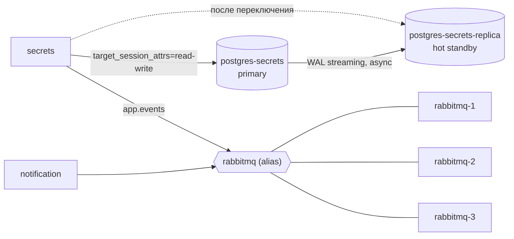

# Надёжность: резервирование, резервное копирование, параметры обслуживания

Документ описывает, как стек переживает отказ СУБД и брокера сообщений, как
делается резервное копирование, и какие параметры обслуживания (SLA/SLO, MTBF,
MTTR, RTO, RPO) из этого следуют. Термины — по лекции 5 «Построение надёжных систем».

## 1. Что зарезервировано

| Компонент | Схема | Дублирование | Переключение |
| --- | --- | --- | --- |
| `secrets_db` | Active/Passive: primary + hot standby, асинхронная потоковая репликация WAL | 2N | Ручное: `make db-promote` |
| RabbitMQ | Кластер из 3 узлов, quorum-очереди (Raft) | 2N+1 | Автоматическое: выборы лидера |
| `auth_db` | Один узел + резервные копии | — | Восстановление из копии |
| gateway, auth, secrets, notification | Без состояния, один экземпляр | — | Автоматический перезапуск Docker (`restart: unless-stopped`) |
| Redis | Только кэш шифротекста | — | Не требуется: secrets работает без Redis |

### 1.1. СУБД secrets_db

- Оба узла — одинаковый образ `postgres:17-alpine` с обёрткой
  [`deploy/postgres/ha-entrypoint.sh`](../deploy/postgres/ha-entrypoint.sh).
  При первом запуске standby клонирует primary через `pg_basebackup -R -X stream`
  и дальше получает WAL потоком.
- Сервис `secrets` знает оба адреса (`POSTGRES_HOST=postgres-secrets,postgres-secrets-replica`)
  и подключается с `target_session_attrs=read-write`: драйвер pgx сам выбирает
  узел, который принимает запись. После переключения ничего перенастраивать не нужно.
- Переключение (`scripts/db.sh promote`):
  1. останавливает старый primary, если он ещё отвечает;
  2. выполняет `pg_promote()` на standby;
  3. **изолирует (fencing)** старый primary: стирает его каталог данных и ставит
     метку `.clone-from-peer`. При следующем запуске (`make db-rejoin`) узел
     клонирует новый primary и становится standby. Без этого `make up` поднял бы
     второй мастер с устаревшими данными — **split-brain**.
- Переключение ручное сознательно: при двух узлах нет арбитра, который отличит
  отказ primary от потери связи между узлами. Автоматический promote в такой схеме
  и приводит к split-brain. Автоматизация требует третьего голоса (Patroni + etcd),
  что для учебного стенда избыточно.

### 1.2. Брокер RabbitMQ

- Три узла `rabbitmq-1..3` в одном кластере (общий Erlang cookie из
  `.secrets/rabbitmq_erlang_cookie`, обнаружение — `classic_config`), конфигурация в
  [`deploy/rabbitmq/cluster-entrypoint.sh`](../deploy/rabbitmq/cluster-entrypoint.sh).
- `notification.events` и DLQ `notification.events.dead` — **quorum-очереди**: каждое
  сообщение реплицируется на все три узла и подтверждается после записи на
  большинство (2 из 3). Отказ одного любого узла, включая лидера очереди, не
  приводит ни к простою, ни к потере сообщений: оставшаяся пара выбирает нового лидера.
- `cluster_partition_handling = pause_minority`: при сетевом разделении узел в
  меньшинстве останавливается, поэтому двух активных половин кластера не бывает.
- Клиенты подключаются по общему сетевому имени `rabbitmq`; Docker DNS возвращает
  адреса только работающих узлов, а циклы переподключения в secrets и notification
  уже были. Код клиентов не менялся.
- Брокер не на пути синхронного API: события сначала коммитятся в outbox
  `secrets_db`. Даже при потере большинства узлов API продолжает работать, события
  ждут в outbox и уходят после восстановления.

### 1.3. Резервное копирование

`make backup` ([`scripts/backup.sh`](../scripts/backup.sh)) делает **полную логическую
копию** (`pg_dump -Fc`, вид «Backup as SQL statements») обеих баз. Шаги
повторяют процедуру из лекции:

| Шаг лекции | Реализация |
| --- | --- |
| Проверка возможности | `pg_isready` на текущем primary |
| Копирование | `pg_dump -Fc` с узла, который сейчас primary |
| Проверка статуса копирования | Код возврата и непустой файл |
| Перемещение копии | Атомарное переименование `*.partial` → `*.dump` в `backups/`, SHA-256 рядом |
| Проверка копии | `pg_restore --list` читает оглавление |
| Восстановление копии (проверочное) | Восстановление во временную БД и сверка числа таблиц, затем её удаление |
| Политика хранения | Хранятся последние `KEEP` (по умолчанию 7) копий каждой базы |

`make restore FILE=backups/secrets_db-<время>.dump` проверяет контрольную сумму,
восстанавливает базу **одной транзакцией** (`--clean --single-transaction`: либо
база полностью соответствует копии, либо не изменилась) и перезапускает Redis,
чтобы в кэше не осталось данных новее копии. Standby получает восстановленные
данные по репликации сам.

Политика копирования: ежедневно, например cron на хосте
`0 3 * * * cd /path/to/simplified-vault && make backup`. Копии нужно переносить
за пределы хоста — на одном диске со стендом они не защищают от его потери.

Важно:

- Без `.secrets/master_key` копия `secrets_db` бесполезна: тексты секретов в ней
  зашифрованы. Ключ хранится отдельно от копий, в том же количестве экземпляров.
- События, лежавшие в outbox в момент копирования, после восстановления будут
  отправлены повторно; события, созданные после копирования, пропадут вместе с данными.
- Реплика не заменяет копию: `TRUNCATE` или ошибочный `DELETE` реплицируются на
  standby за доли секунды (это показывает `make demo-backup`).

## 2. Демонстрация

Каждый сценарий идёт через публичный HTTPS gateway, как настоящий клиент, и
печатает замеренное время восстановления.

| Команда | Сценарий | Результат на стенде |
| --- | --- | --- |
| `make demo-db-failover` | Секрет → SIGKILL primary → запись даёт HTTP 500 → `db.sh promote` → запись снова работает → старый секрет читается → старый primary возвращается standby | Запись недоступна 1,5–10 с |
| `make demo-mq-failover` | Секрет → SIGKILL лидера quorum-очереди → чтение секрета → письмо доходит через оставшиеся узлы → узел возвращается и догоняет журнал | Письмо пришло через 5 с после отказа, без потерь и дублей |
| `make demo-backup` | Секрет → `make backup` → `TRUNCATE secrets CASCADE` → HTTP 404 → `make restore` → секрет читается | Восстановление ≈ 1 с |

`make db-status` в любой момент показывает роли узлов и отставание реплики.

В демо СУБД переключение запускает скрипт сразу после отказа, поэтому простой —
секунды. В эксплуатации к нему добавляется время, пока дежурный заметит отказ и
выполнит команду; это учтено в MTTR ниже.

## 3. Параметры обслуживания

### 3.1. SLA

| Пункт SLA | Значение |
| --- | --- |
| Услуги | Хранение и выдача секретов (API `/secrets`), аутентификация (`/auth`), email-уведомления |
| Временные рамки | 24×7, измерение за календарный месяц |
| SLO доступности API | **99,5 %** успешных ответов (не 5xx и не таймаут) |
| SLO уведомлений | **99 %** писем отправлены в течение 1 минуты после события |
| SLI | Доля успешных healthcheck gateway / ответов `make smoke` за месяц; задержка «коммит события → письмо в Mailpit» |
| Бюджет ошибок | 100 % − 99,5 % = 0,5 % = **3,6 ч в месяц** (720 ч по таблице лекции) |
| MTTR (целевой) | 15 мин для отказа СУБД, 30 с для отказа узла брокера |
| Ответственность | Владелец стенда; при исчерпании бюджета ошибок изменения стенда замораживаются до разбора инцидента |

### 3.2. Надёжность компонентов

MTBF стенда не измерен — данных за длительный срок нет. Принято допущение:
**один незапланированный отказ узла в квартал**, MTBF = 2160 ч (OOM, переполнение
диска, перезагрузка хоста, ошибка обновления). Для хоста целиком — один отказ в
год, MTBF = 8640 ч. MTTF не используется: все компоненты восстанавливаемые.

Доступность компонента: **A = MTBF / (MTBF + MTTR)**.

| Компонент | MTBF, ч | MTTR | Почему такой MTTR | A |
| --- | --- | --- | --- | --- |
| `secrets_db` (primary + standby) | 2160 | 15 мин | Обнаружение по алерту и `make db-promote`; сама команда — секунды (замер демо) | 99,988 % |
| `secrets_db` без standby (для сравнения) | 2160 | 1 ч | Восстановление из копии + проверка | 99,954 % |
| Кластер RabbitMQ (отказ 1 узла) | 2160 | 0 для API, 30 с для уведомлений | Выборы лидера — секунды, backoff клиентов до 30 с | 100 % для API |
| `auth_db` | 2160 | 30 с (сбой процесса) | Перезапуск Docker; потеря тома — восстановление из копии, RTO 30 мин | 99,9996 % |
| gateway, auth, secrets | 2160 | 30 с | Перезапуск Docker и healthcheck | 99,9996 % каждый |
| Хост | 8640 | 4 ч | Пересборка стенда на новом хосте из Git + копий + `.secrets/` | 99,954 % |

API работает, только если работают все компоненты на его пути: gateway, auth,
`auth_db`, secrets, `secrets_db` и хост. Доступность последовательной цепочки — произведение:

**A ≈ 0,99954 × 0,99988 × 0,999996⁴ ≈ 99,94 %**,

то есть ≈ 26 мин простоя в месяц. Это больше SLO 99,5 % с запасом: оставшиеся
≈ 3 ч бюджета ошибок покрывают плановые работы (пересборка образов, `make up`),
неточность допущения о MTBF и ручное восстановление `auth_db` из копии. Брокер в
цепочку не входит благодаря outbox.

Видно, что главный вклад даёт хост — единая точка отказа. Standby `secrets_db`
сокращает MTTR базы с часа до 15 минут, но не спасает от потери хоста.

### 3.3. RTO и RPO

| Отказ | RTO | RPO | Обоснование |
| --- | --- | --- | --- |
| Отказ primary `secrets_db` | 15 мин | Секунды | Асинхронная репликация: может потеряться хвост WAL, не дошедший до standby. На стенде отставание 0 байт |
| Отказ узла RabbitMQ | 0 (API), 30 с (письма) | 0 | Quorum подтверждает запись после большинства, outbox хранит неотправленное |
| Потеря 2 из 3 узлов RabbitMQ | До восстановления узла | 0 | События ждут в outbox |
| Логическая порча / удаление данных | 30 мин | 24 ч | Ежедневная копия; восстановление на стенде ≈ 1 с, остальное — поиск нужной копии и проверка |
| Отказ `auth_db` с потерей тома | 30 мин | 24 ч | Реплики нет, только копия |
| Потеря хоста | 4 ч | 24 ч | Если копии и `.secrets/` вынесены за пределы хоста |

### 3.4. Классификация по лекции

- **HA, а не FT.** Переключение СУБД сопровождается коротким простоем записи
  (секунды при автоматическом запуске команды, минуты — при ручном), поэтому
  это высокая доступность, а не отказоустойчивость без деградации. Ближе всего к FT
  брокер: отказ узла для клиентов незаметен, кроме задержки в несколько секунд.
- **DR:** standby — горячий резерв (hot), копии `pg_dump` — холодный (cold).
- **CAP:** пара PostgreSQL с асинхронной репликацией и ручным переключением
  предпочитает согласованность (CP): без primary запись отклоняется, а не
  принимается на двух узлах. Quorum-очереди RabbitMQ — тоже CP: без большинства
  очередь недоступна.
- **Балансировка:** клиенты брокера выбирают узел через DNS (round robin по
  живым узлам); клиент СУБД перебирает хосты по порядку и оставляет тот, что
  принимает запись.

## 4. Вопросы для обсуждения

**Синхронная или асинхронная репликация.** Выбрана асинхронная. Синхронная дала бы
RPO = 0 при отказе primary, но с единственным standby его остановка блокирует
каждый `COMMIT` на primary, то есть отказ любого из двух узлов останавливает запись.
Для сервиса, где потеря нескольких последних секунд записей допустима, а простой
— нет, асинхронная репликация лучше. Чтобы получить RPO = 0 без этой проблемы,
нужен третий узел и `synchronous_standby_names = 'ANY 1 (...)'` — как на схеме
кластера из лекции (Primary → Secondary → Async replica).

**HA или FT.** FT требует, чтобы отказ был незаметен клиентам. Для брокера это почти
достигнуто (2N+1 узлов, автоматические выборы). Для СУБД — нет: нужны
автоматический арбитр и синхронная реплика, а это уже Patroni, etcd и три узла.
SLO 99,5 % этого не требует.

**Репликация или резервное копирование.** Это не альтернативы. Репликация защищает от
отказа узла и даёт малые RTO/RPO, но мгновенно копирует ошибки и злонамеренные
изменения. Резервная копия защищает от логической порчи и потери хоста, но с
RPO = интервал копирования. Нужны оба механизма.

## 5. Ограничения стенда

- Все узлы на одном Docker-хосте: демонстрируется механизм, а не устойчивость к
  отказу оборудования. В эксплуатации узлы разносятся по хостам или зонам доступности.
- Переключение `secrets_db` ручное; автоматическое требует третьего голоса.
- У `auth_db` нет реплики (сделать по образцу `secrets_db`); при отказе её тома
  данные восстанавливаются из копии с RPO 24 ч.
- Копии лежат в `backups/` на том же хосте и не переносятся автоматически.
- Резервное копирование только полное; инкрементальное с архивом WAL
  (`pg_basebackup` + `archive_command`) уменьшило бы RPO с суток до минут.
- В RabbitMQ 4 у quorum-очередей лимит повторных доставок — 20: сообщение,
  возвращённое в очередь 20 раз (например, из-за остановки notification посреди
  обработки), уходит в DLQ. Повторы при ошибках SMTP идут внутри notification
  и в этот лимит не входят.
